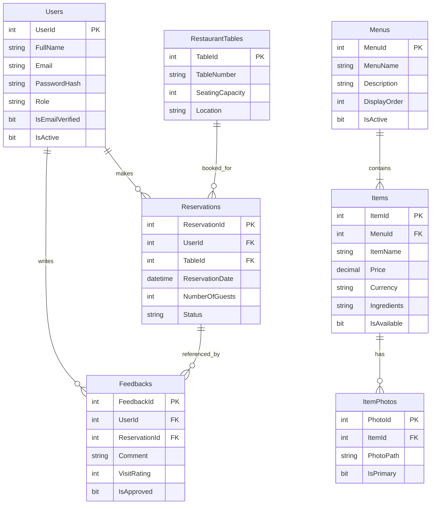
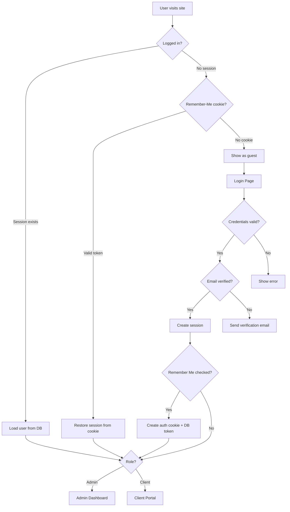

<div align="center">

# 🍽️ RestoApp

### Restaurant Content Management System

A modern, full-stack restaurant management platform built with ASP.NET Web Forms — featuring online menu browsing, table reservations, customer reviews, and a complete admin dashboard.

[](https://dotnet.microsoft.com/download/dotnet-framework)
[](https://dotnet.microsoft.com/apps/aspnet)
[](https://docs.microsoft.com/sql/database-engine/configure-windows/sql-server-express-localdb)
[](https://getbootstrap.com/)
[](LICENSE.txt)

---

[Features](#-features) · [Architecture](#-project-architecture) · [Getting Started](#-getting-started) · [Configuration](#-configuration) · [Database](#-database-schema) · [Contributing](#-contributing)

</div>

<br/>

## 📋 Table of Contents

- [Features](#-features)
- [Project Architecture](#-project-architecture)
- [Tech Stack](#-tech-stack)
- [Getting Started](#-getting-started)
- [Configuration](#-configuration)
- [Database Schema](#-database-schema)
- [Authentication Flow](#-authentication-flow)
- [Key Design Decisions](#-key-design-decisions)
- [Contributing](#-contributing)
- [License](#-license)

<br/>

## ✨ Features

<table>
<tr>
<td width="50%" valign="top">

### 🛍️ Client Portal

- **Menu Browsing** — explore categorized menus with item details, photos, prices, ingredients, and origin
- **Shopping Cart** — session-based cart system for building orders
- **Table Reservations** — browse restaurant tables by location and capacity, then submit reservation requests
- **Reviews & Ratings** — submit feedback with a 1–5 star rating system
- **Responsive Design** — fully mobile-optimized with Bootstrap 5 and scroll animations

</td>
<td width="50%" valign="top">

### 🔧 Admin Dashboard

- **Analytics Overview** — real-time dashboard with key restaurant metrics
- **User Management** — view, activate, and deactivate user accounts
- **Menu Management** — create, edit, reorder, and toggle menu categories
- **Item Management** — full CRUD with multi-photo uploads per item
- **Table Management** — configure tables with capacity, location, and photos
- **Reservation Management** — approve, reject, and track bookings
- **Review Moderation** — approve or remove customer feedback before it goes live

</td>
</tr>
</table>

### 🔐 Authentication & Security

| Feature | Implementation |
|:---|:---|
| Password Hashing | BCrypt (industry-standard adaptive hashing) |
| Email Verification | Time-limited token sent via SMTP on signup |
| Remember Me | Secure cookie with GUID token stored server-side |
| Password Reset | Token-based reset flow with email delivery |
| Role-Based Access | `Admin` / `Client` roles enforced at the page level |
| Session Security | HttpOnly cookies, server-side session validation |

<br/>

## 🏗️ Project Architecture

The project follows a **layered architecture** separating views, data access, models, and shared helpers:

```
RestaurantCMS/
│
├── 📄 README.md
├── 📄 LICENSE.txt
├── 📄 .gitignore
├── 📄 RestoApp.slnx                  # Visual Studio solution
│
└── RestoApp/                          # Main web application
    │
    ├── 🗂️ Models/                     # Data transfer objects
    │   ├── Item.cs                    #   Menu item model
    │   ├── Menu.cs                    #   Menu category model
    │   ├── Reservation.cs             #   Booking model
    │   ├── RestaurantTable.cs         #   Table model
    │   ├── Feedback.cs                #   Customer review model
    │   └── CartItem.cs                #   Shopping cart item
    │
    ├── 🗂️ Helper/                     # Shared utilities
    │   ├── AuthHelper.cs              #   Authentication & session logic
    │   ├── DbHelper.cs                #   SQL connection factory
    │   └── EmailService.cs            #   SMTP email sender
    │
    ├── 🗂️ AdminRepo/                  # Admin data access layer
    │   ├── UserRepositoryAdmin.cs
    │   ├── MenuRepositoryAdmin.cs
    │   ├── ItemRepositoryAdmin.cs
    │   ├── TableRepositoryAdmin.cs
    │   ├── ReservationRepositoryAdmin.cs
    │   └── FeedbackRepositoryAdmin.cs
    │
    ├── 🗂️ ClientRepo/                 # Client data access layer
    │   ├── ItemMenuRepository.cs
    │   ├── TableRepository.cs
    │   ├── ReservationRepository.cs
    │   ├── FeedbackRepository.cs
    │   └── CartManager.cs
    │
    ├── 🗂️ AdminView/                  # Admin pages (Web Forms)
    │   ├── Dashboard/
    │   ├── Users/
    │   ├── Menus/
    │   ├── Items/
    │   ├── Tables/
    │   ├── Reservations/
    │   └── Feedbacks/
    │
    ├── 🗂️ ClientsView/                # Client pages (Web Forms)
    │   ├── Menu/
    │   ├── Items/
    │   ├── Tables/
    │   ├── TableDetails/
    │   ├── Reservationn/
    │   ├── Cart/
    │   └── Feedbacks/
    │
    ├── 🗂️ Authentication/             # Auth pages
    │   ├── Login.aspx
    │   ├── Signup.aspx
    │   ├── Verify.aspx
    │   ├── ForgotPassword.aspx
    │   └── ResetPassword.aspx
    │
    ├── 🗂️ Content/                    # Static assets
    │   ├── css/                       #   Custom themes & styling
    │   └── js/                        #   Client-side scripts
    │
    ├── 🗂️ App_Data/                   # Database artifacts
    │   ├── restoDb.sql                #   Full schema
    │   ├── dummyData.sql              #   Sample seed data
    │   └── migrations/               #   Schema change scripts
    │
    ├── 📄 Site.Master                 # Master page (layout)
    ├── 📄 Default.aspx                # Home / landing page
    └── 📄 Web.config                  # App configuration
```

<br/>

## 🔧 Tech Stack

| Category | Technology | Purpose |
|:---|:---|:---|
| **Runtime** | .NET Framework 4.8 | Application framework |
| **Web Framework** | ASP.NET Web Forms | Server-side page rendering with code-behind |
| **Database** | SQL Server LocalDB | Relational data storage |
| **Data Access** | ADO.NET | Raw `SqlConnection` / `SqlCommand` for full control |
| **Password Security** | BCrypt.Net-Next 4.2 | Adaptive password hashing |
| **Email** | System.Net.Mail | SMTP email delivery |
| **UI Framework** | Bootstrap 5.3 | Responsive layout and components |
| **Icons** | Font Awesome 6.4 | Icon library |
| **Animations** | AOS (Animate on Scroll) | Scroll-triggered entrance animations |
| **Build System** | MSBuild | Compilation and packaging |
| **IDE** | Visual Studio 2022+ | Development environment |

<br/>

## 🚀 Getting Started

### Prerequisites

| Requirement | Details |
|:---|:---|
| **Visual Studio** | 2022 or later, with the **ASP.NET and web development** workload |
| **SQL Server LocalDB** | Included with Visual Studio installation |
| **SMTP Account** | Gmail with [App Password](https://support.google.com/accounts/answer/185833), or any SMTP provider |

### Step 1 — Clone the Repository

```bash
git clone https://github.com/your-username/RestaurantCMS.git
cd RestaurantCMS
```

### Step 2 — Restore NuGet Packages

Open `RestoApp.slnx` in Visual Studio — packages restore automatically on build.

Or restore manually via the **Package Manager Console**:

```
nuget restore RestoApp.slnx
```

### Step 3 — Create the Database

1. Open **SQL Server Object Explorer** in Visual Studio (`View → SQL Server Object Explorer`)
2. Expand your LocalDB instance → right-click **Databases** → **Add New Database** → name it `RestoDB`
3. Right-click the new database → **New Query**
4. Run the schema:

```
RestoApp/App_Data/restoDb.sql
```

5. *(Optional)* Populate sample data:

```
RestoApp/App_Data/dummyData.sql
```

> [!TIP]
> The seed script inserts 4 menu categories, 20 menu items with Unsplash photos, 20 tables across different locations, 3 sample reservations, and 3 approved reviews — giving you a fully functional demo right away.

### Step 4 — Configure SMTP

Open `RestoApp/Web.config` and set your email credentials in the `<appSettings>` section:

```xml
<appSettings>
    <add key="SmtpHost" value="smtp.gmail.com" />
    <add key="SmtpPort" value="587" />
    <add key="SmtpUser" value="your-email@gmail.com" />
    <add key="SmtpPass" value="your-app-password" />
</appSettings>
```

> [!CAUTION]
> **Never commit real credentials to version control.** The repository ships with placeholder values. Update them locally for development, and use environment-specific Web.config transforms for production.

### Step 5 — Run the Application

Press **`F5`** in Visual Studio to launch with IIS Express.

The app will open at `http://localhost:<port>/` with the home page.

<br/>

## ⚙️ Configuration

All application settings live in [`RestoApp/Web.config`](RestoApp/Web.config):

### App Settings

| Key | Description | Default Value |
|:---|:---|:---|
| `SmtpHost` | SMTP server hostname | `smtp.gmail.com` |
| `SmtpPort` | SMTP server port | `587` |
| `SmtpUser` | Sender email address | `your-email@gmail.com` |
| `SmtpPass` | Email app password | `your-app-password` |

### Connection String

| Name | Description |
|:---|:---|
| `RestoDbConnection` | SQL Server LocalDB connection with `AttachDbFilename` pointing to `App_Data\RestoDB.mdf` |

> [!NOTE]
> If you created the database manually (not via AttachDbFilename), update the connection string to use `Initial Catalog=RestoDB` instead.

<br/>

## 🗄️ Database Schema

The system uses **7 relational tables** with proper foreign keys and constraints:



> Full schema script: [`RestoApp/App_Data/restoDb.sql`](RestoApp/App_Data/restoDb.sql)
> Sample data: [`RestoApp/App_Data/dummyData.sql`](RestoApp/App_Data/dummyData.sql)

<br/>

## 🔐 Authentication Flow



| Flow | Description |
|:---|:---|
| **Signup** | Validates inputs → hashes password with BCrypt → saves user → sends verification email with a 1-hour token |
| **Email Verification** | Validates token + expiry → marks `IsEmailVerified = 1` → clears token |
| **Login** | Checks credentials → validates account status → creates session → optionally sets 7-day remember-me cookie |
| **Remember Me** | GUID token stored in `AuthCookie` (HttpOnly) and `Users.AuthToken` column. Validated on each visit if session is missing. |
| **Forgot Password** | Generates reset token → sends email. Shows generic message to prevent email enumeration. |
| **Reset Password** | Validates reset token → hashes new password → clears all auth tokens (invalidates existing sessions) |
| **Admin Guard** | `AuthHelper.RequireAdmin()` checks: logged in → active → verified → role is Admin |

<br/>

## 💡 Key Design Decisions

| Decision | Rationale |
|:---|:---|
| **Raw ADO.NET** over Entity Framework | Full control over queries, minimal abstraction, easier to understand for learning purposes |
| **Session + Cookie auth** over ASP.NET Identity | Simpler implementation, demonstrates core auth concepts without framework magic |
| **Repository pattern** | Separates data access from UI logic; distinct repos for admin and client operations |
| **BCrypt** for password hashing | Industry-standard adaptive hashing that automatically handles salting |
| **Moderated reviews** | `IsApproved` flag on feedbacks prevents spam from appearing on the public site |
| **Soft deletes** | `IsActive` flags on users, menus, and tables instead of destructive `DELETE` operations |
| **Config-based secrets** | SMTP credentials read from `Web.config` appSettings, not hardcoded in source |

<br/>

## 🤝 Contributing

Contributions are welcome! Here's how:

1. **Fork** the repository
2. **Create** a feature branch
   ```bash
   git checkout -b feature/your-feature-name
   ```
3. **Commit** your changes with a clear message
   ```bash
   git commit -m "Add: description of your changes"
   ```
4. **Push** to your fork
   ```bash
   git push origin feature/your-feature-name
   ```
5. **Open** a Pull Request with a description of what you changed and why

### Code Style

- Follow existing naming conventions (PascalCase for methods/properties, camelCase for locals)
- Use parameterized SQL queries — **never concatenate user input into SQL strings**
- Keep code-behind files focused; move reusable logic to `Helper/` or repository classes

<br/>

## 📄 License

This project is licensed under the **MIT License** — see the [LICENSE.txt](LICENSE.txt) file for details.

<br/>

---

<div align="center">

**Built with ❤️ using ASP.NET Web Forms**

</div>